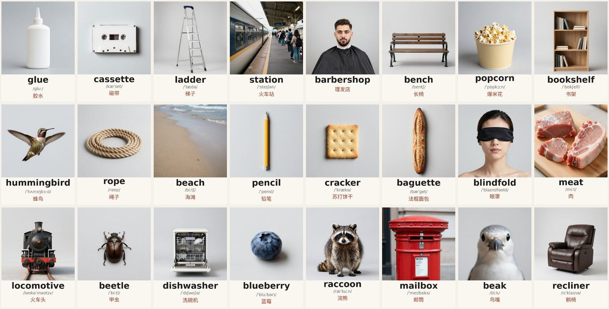
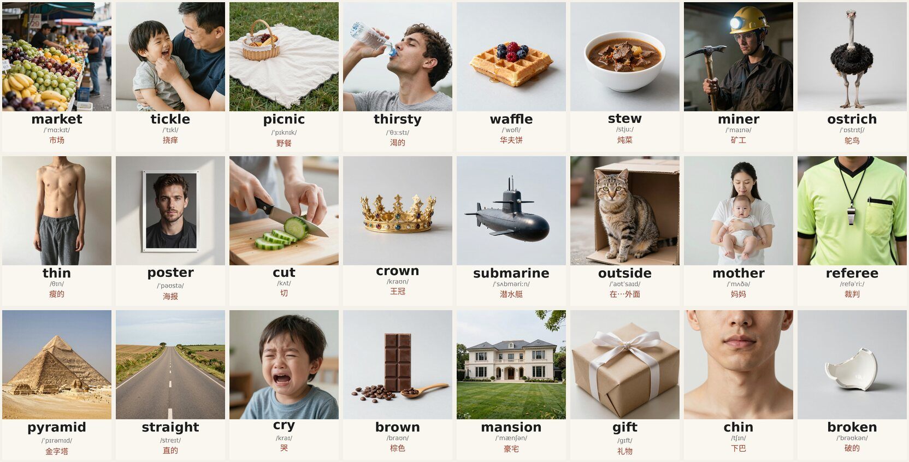

# wordcards

1271 picture cards for everyday English words, and the pipeline that made them.

Each card is a picture with the word, its phonetics and its Chinese meaning underneath. The pictures
are AI-generated. Set 1 (771 cards) is everyday nouns picked from a dictionary by script and then
reviewed by hand; set 2 (500 cards) was written by hand and adds the basics that set 1 missed: more
nouns, jobs and people, actions, adjectives, colours and shapes, seasons and position words. Everything
here is open so you can rebuild it, change it or make your own set.





Made to be shown one after another on the desktop by [wordnote](https://github.com/MichaelMuClaude/wordnote),
a small sticky-note app: you glance at the cards while you work, and click **Got it** on the ones you
already know.

## 中文简介

共 1271 张日常英语卡片：一张图配上单词、音标和中文释义，图片由 AI 生成。
第一组 771 张是日常名词，先用脚本从 ECDICT 词典里筛选，再人工逐个审过（只留生活里看得见、画得出来的东西）；
第二组 500 张是手写的名单，补上第一组漏掉的基础词：更多名词、职业和人物、动作、形容词、颜色和形状、季节和方位词。
整套流程（选词、出图、加字）都在这个仓库里，可以自己重做或换成别的词表。配合桌面便签小程序
[wordnote](https://github.com/MichaelMuClaude/wordnote) 使用：干活时随手瞄几眼，认识的点 **Got it** 就不再出现。

## Download

The pictures are too big for the repository, so they are attached to the
[Releases](https://github.com/MichaelMuClaude/wordcards/releases) page:

| File | What is in it | Size |
|---|---|---|
| `wordcards-v1-cards.zip` (v1.0.0) | set 1: 771 finished cards (picture + word + phonetics + Chinese), 1024x1404 JPEG | about 107 MB |
| `wordcards-v1-pictures-only.zip` (v1.0.0) | set 1: the same 771 pictures without text, 1024x1024 JPEG | about 92 MB |
| `wordcards-v1.1-set2-cards.zip` (v1.1.0) | set 2: 500 finished cards | about 76 MB |
| `wordcards-v1.1-set2-pictures-only.zip` (v1.1.0) | set 2: the same 500 pictures without text | about 67 MB |

The two sets have no words in common, so you can unzip both into one folder.

## What is in this repository

| Path | Content |
|---|---|
| `data/cards.tsv` | set 1: word, IPA, Chinese meaning, category, ECDICT frequency rank, and the prompt used to draw it |
| `data/zh.json` | the Chinese meanings of set 1 (short everyday wording, written by hand rather than copied from the dictionary) |
| `data/candidates_rank20000.tsv` | 2988 concrete-noun candidates picked from the dictionary before the manual review of set 1 |
| `data/review/` | the manual review of set 1, one file per letter: which words to keep, and how to draw the ambiguous ones |
| `data/set2/cards.tsv` | set 2: the same columns as above |
| `data/set2/specs/` | the hand-written set 2 word lists (`word\|Chinese\|prompt`), and `fixes.txt` with the prompts rewritten after the first drawing round |
| `scripts/` | the pipeline steps below |
| `workflow/z_image_turbo_api.json` | the ComfyUI graph used for every picture (API format) |

## How the cards were made

**Set 1**

1. **Pick candidates** (`scripts/01_screen_nouns.py`). Take the 20000 most frequent entries of
   [ECDICT](https://github.com/skywind3000/ECDICT) that are single-word nouns, and keep those whose
   first [WordNet](https://wordnet.princeton.edu/) sense is something concrete (animal, artifact, food,
   body, plant, natural object, substance, weather). That gives 2988 words, including many that are not
   really drawable (`bank` as a river bank, `blackjack`, `bender` ...).
2. **Review by hand** (`data/review/*.txt`, `scripts/02_build_cards.py`). Keep only everyday things you can
   point at and draw: no abstract, scientific, medical, military or obscure words. For every word that
   has more than one common meaning, write the picture description (`bat` = a bat hanging upside down,
   `bulb` = a light bulb). 771 words remain.

**Set 2**

The filter above cannot find words like `table` or `book` (WordNet's first sense for them is abstract) and
has no jobs, actions or adjectives. So set 2 is a hand-written list, checked against ECDICT for
phonetics: `data/set2/specs/`, built by `scripts/05_build_set2.py`. Actions are drawn as a person doing
them (`hug` = two friends hugging), adjectives with a typical scene (`big` = an elephant next to a tiny
person), colours with a still life of things of that colour. Four words were left out because set 1
already has the same word as a different thing: the colour `orange`, and the actions `fly`, `paint`
and `slide`.

**Both sets**

3. **Draw** (`scripts/03_generate.py`). One 1024x1024 picture per word with a local
   [ComfyUI](https://github.com/comfyanonymous/ComfyUI) server running Z-Image-Turbo (9 steps, about 3
   seconds per picture on an RTX 5090). Objects get a plain light-grey studio background; scenes
   (landscapes, rooms, buildings, people doing things) get natural light instead.
4. **Label** (`scripts/04_label.py`). Pillow adds a strip with the word, IPA and Chinese meaning.

In both sets the first pass left some pictures weak or wrong (an empty room for `attic`, a button for
`mushroom`, a pencil for `crayon`; in set 2 a human face for `bright` and a single chopstick for
`chopsticks`). The prompts for those were rewritten and the pictures redrawn: 36 in set 1 (see
`data/review/extra.txt`) and 10 in set 2 (`data/set2/fixes.txt`).

## Rebuild it yourself

```bash
pip install -r requirements.txt
python -c "import nltk; nltk.download('wordnet')"

# set 1
python scripts/01_screen_nouns.py ecdict.csv data/candidates_rank20000.tsv   # download ecdict.csv from the ECDICT repository first
python scripts/02_build_cards.py                                             # -> data/cards.tsv

# set 2
python scripts/05_build_set2.py ecdict.csv                                   # -> data/set2/cards.tsv

# draw (ComfyUI running with z_image_turbo_bf16, qwen_3_4b and z_image_ae installed), then add the text strip
python scripts/03_generate.py data/cards.tsv raw/
python scripts/04_label.py data/cards.tsv raw/ cards/
python scripts/03_generate.py data/set2/cards.tsv raw2/ --seed 9000
python scripts/04_label.py data/set2/cards.tsv raw2/ cards2/
```

Step 4 expects DejaVu Sans and Noto Sans CJK at the paths at the top of `scripts/04_label.py`.

## Things to know

- **The pictures are not perfect.** Some have stray text the model drew by itself (a shop sign, the
  writing on a toothpaste tube, a made-up brand on a battery), some are a bit small in the frame, and a
  few words are shown by one of several possible things (`mouse` is the animal, not the computer mouse).
  I checked every picture as a thumbnail, not at full size. Actions and adjectives are harder to draw than
  objects, so set 2 has more cases where the picture only roughly fits.
- **People.** Set 2 has pictures of people. They are AI-generated faces, not real photographs of anyone.
- **Seeds.** The published sets were drawn in several batches, so re-running step 3 gives similar but not
  identical pictures.
- **Phonetics** come from ECDICT, converted to standard IPA symbols (24 broken or missing entries were fixed by
  hand in `scripts/ipa.py`). They follow British-style notation, and a word-final `i` is written `ɪ`
  (thirsty is `/ˈθɜːstɪ/`), as in ECDICT's own notation.
- **Chinese meanings** were written with the help of an AI model and have not been proofread by a
  professional; corrections are welcome.
- The cards are all in one realistic-photo style. To get a different look, change the prompt suffixes in
  `scripts/03_generate.py` and redraw.

## License and credits

- Code in this repository: MIT, see [LICENSE](LICENSE).
- The picture cards, the `cards.tsv` files, `data/zh.json`, the set 2 word lists and the review files:
  CC BY 4.0 (credit "wordcards by Michael Mu"). The pictures are AI-generated, and how copyright
  applies to such images differs between countries.
- The word list, phonetics and frequency ranks are derived from ECDICT (MIT) and the category filter
  uses WordNet. Full credits and the licenses of the tools and models used are in [NOTICE.md](NOTICE.md).
